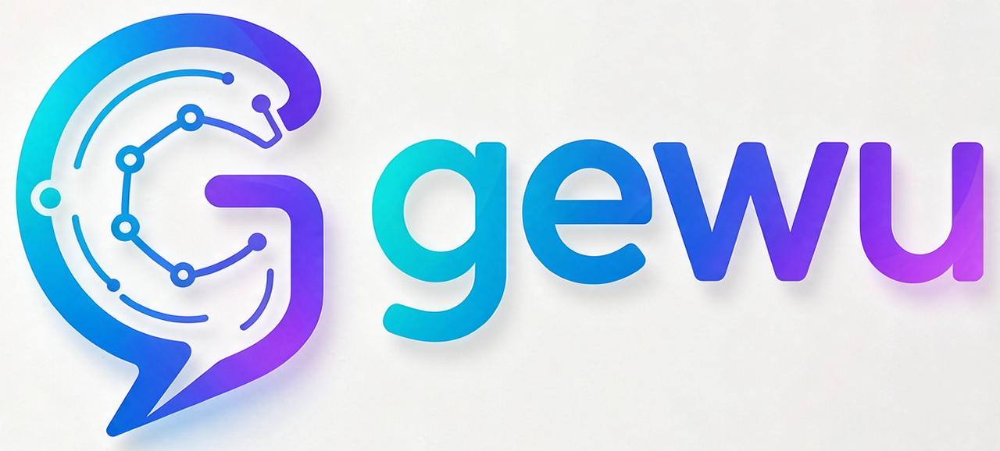

# Gewu Web — Enterprise AI Agent Platform Frontend (Vue 3)

<p align="center"></p>

[](https://vuejs.org)
[](https://vitejs.dev)
[](https://github.com/gewu-platform/gewu/blob/develop/LICENSE)

**Gewu Web** is the frontend of the Gewu AI-native application platform. It pairs with the [gewu](https://github.com/gewu-platform/gewu) backend (Java 17 + Spring Boot 3 + LangChain4j, port 8081) to form the complete platform.

[中文](README.md)

## ✨ Features

| Page | Description |
|------|------|
| 💬 **AI Chat** | Multi-turn sessions, SSE token-by-token streaming, Markdown rendering + code highlighting, multimodal image input (paste or upload), slash commands, context usage indicator |
| 🤖 **Agent Orchestration** | Template creation wizard (knowledge QA / customer service / general assistant) → persona → knowledge binding; live reasoning timeline, tool calls, and approval cards |
| 📚 **RAG Knowledge Base** | md/txt/pdf/docx upload, async indexing, retrieval test bench (similarity score visualization) |
| 🧩 **Prompt Management** | Versioned templates (auto-increment +1 on create), variable extraction, rendered execution, one-click rollback |
| 📊 **Monitoring & Reports** | LLM call traces, today's stats cards, 24h distribution, model leaderboard; usage reports in three views (day/user/agent) |
| ⚙️ **Model Configuration Center** | chat/embedding provider management, masked API keys, connectivity tests, save-and-apply |
| 🌐 **i18n** | Built-in Chinese/English switching (vue-i18n), browser-language detection, persisted per browser |

## 🛠 Tech Stack

- Vue 3 (Composition API) + Vite 5
- Pinia state management / Vue Router
- Axios HTTP client
- vue-i18n internationalization
- Marked.js Markdown rendering + Highlight.js code highlighting

## 🚀 Quick Start

**Prerequisites**: Node 18+, and the [gewu](https://github.com/gewu-platform/gewu) backend running (default port 8081).

```bash
# Install dependencies (pnpm or npm — both lockfiles are provided)
pnpm i        # or npm i

# Start the dev server (port 3001, auto-proxies to backend 8081)
pnpm run dev  # or npm run dev

# Production build
pnpm run build
```

Open `http://localhost:3001` in your browser and sign in (the default admin account is documented in the backend's `.env.example` comments).

## 🔗 Backend Integration

In dev mode, Vite auto-proxies `/api` → `http://localhost:8081` (see `vite.config.js`) — no extra configuration needed.

For production, serve `dist/` with nginx and reverse-proxy `/api` to the backend (full configuration in the backend repo's [docs/DEPLOY.md](https://github.com/gewu-platform/gewu/blob/develop/docs/DEPLOY.md)).

## 📁 Project Structure

```
gewu-web/
├── index.html                  # entry (Gewu branding/favicon)
├── vite.config.js              # Vite config + /api proxy
├── src/
│   ├── main.js                 # app entry
│   ├── App.vue                 # layout + top navigation + language switcher
│   ├── i18n/                   # internationalization (zh-CN / en-US locales)
│   ├── router/index.js         # routes (/chat /agent /knowledge /prompt /monitor /models)
│   ├── stores/                 # Pinia state
│   ├── api/                    # backend API clients (chat/agent/knowledge/monitor/settings)
│   ├── components/             # AuthModal, agent approval cards, etc.
│   └── views/
│       ├── ChatView.vue        # AI chat
│       ├── AgentView.vue       # agent orchestration (wizard + chat)
│       ├── KnowledgeView.vue   # knowledge base management
│       ├── PromptView.vue      # prompt templates
│       ├── MonitorView.vue     # monitoring & usage reports
│       ├── ModelView.vue       # model list
│       └── SettingsView.vue    # model configuration center
```

## 📄 License

Apache-2.0 (same as the backend)
